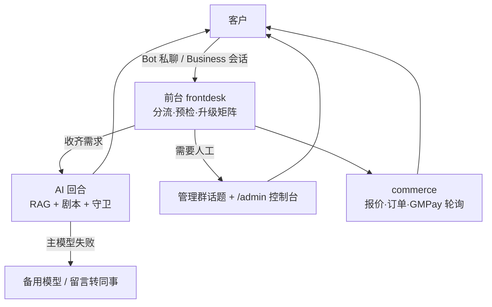

<h1 align="center">Telegram Business AI Bot 🤖</h1>

<p align="center">
  <a href="https://github.com/ChiSonKon/telegram-business-ai-bot/stargazers"></a>
  <a href="https://github.com/ChiSonKon/telegram-business-ai-bot/issues"></a>
  <a href="https://github.com/ChiSonKon/telegram-business-ai-bot/network/members"></a>
  <a href="https://github.com/ChiSonKon/telegram-business-ai-bot/blob/main/LICENSE"></a>
</p>

<p align="center">
  <strong>简体中文</strong> | <a href="#english">English</a>
</p>

<p align="center">
  <a href="https://core.telegram.org/bots/features#secretary-bots">
    
  </a>
</p>

<p align="center">
  <strong>面向业务账号的 Telegram 双向智能客服:同时服务 Bot 私聊与 Business 会话。规则驱动的前台接待 + AI 问答 + 人工一键接管 + USDT 收款 + Telegram 内可视化后台。</strong>
</p>

---

## 💡 核心特性

**接待与成交**
- **双通道**:Bot 私聊(按钮菜单、卡片、表情反应、置顶等)与 Telegram Business「秘书机器人」模式(无需交出账号)共用同一套前台逻辑,按通道能力自动降级。
- **规则驱动的前台**:先分流(软件 / 定制 / 网络 / 空投 / 售后 / 合作),再用 2–5 个问题把需求问清,收齐后才交给 AI 或同事;预检阶段零模型、不耗 token。
- **AI 问答 + 知识库**:`knowledge_base.json` 按业务线检索注入,防价格/链接/地址幻觉(守卫会拦截未授权的金额、链接与收款地址);多模型容灾(DeepSeek / OpenAI 兼容 / Ollama),主模型失败自动切备用。
- **多业务并行**:客户同时问多个业务时,保留主线、登记并行意向、衔接话术、交接带全部业务。
- **中英双语**:首句判定 + 粘性切换(单个英文术语如 IP/USDT 不会误切语言)。
- **售后与复购**:已知问题自助卡、卡密自动打码、24 小时回访、到期续费提醒。

**人工接管与运营**
- **话题式管理群**:每位客户一个 Forum Topic;同事在话题里回复即接手,AI 自动暂停;标记已解决后可恢复 AI。
- **TG 内控制台** `/admin` 与设置中心 `/cfg`:待跟进队列、订单、数据看板、管理员与角色(业主/主管/客服/财务)、商品与类目向导、AI 引擎配置、配置草稿→发布→回滚。
- **防骚扰**:入口护盾(洪泛/重复折叠)、频率限制、Bot 私聊必须先选业务才放行、人机验证按需触发、冒充官方账号识别并告警。

**收款**
- 对接 **GMPay v2(EPUSDT)** 网关:报价 → 选网络 → 20 秒轮询到账 → 自动入账/交付;支持金额容差、过期报价、提交哈希人工核对。**付款成立只信网关,客户截图/自述永远只进人工核验。**
- 另有 TON / Stars 的旧路径(默认不内置任何收款地址,见下方安全说明)。

> [!TIP]
> **🚀 推荐组合：打造你的 Telegram 商业增长矩阵**
>
> 将本项目与 **TG 自动获客助手** 配合使用，打通多账号获客、活跃成员采集、社群运营、批量触达与 AI 私信客服，覆盖从引流、培育到成交转化的完整业务链路。
>
> 👉 **[点击获取 TG 自动获客助手](https://github.com/ChiSonKon/tg-sender-releases)**

---

## 🏗️ 架构



目录:`interactive-bot/`(应用)· `whitecat_core/`(语言判定/护盾/熔断/会话版本等无框架依赖的核心)· `db/`(SQLAlchemy 模型与迁移)· `tests_core/`(约 400 项测试 + 对话模拟器)· `docs/design/`(产品与架构设计文档)。

---

## 🚀 快速开始

### 1. 前置条件
- Python 3.10+(生产环境使用 3.12)
- 在 [@BotFather](https://t.me/BotFather) 创建 Bot;一个开启 **Topic 话题** 的管理群(把 Bot 设为管理员)
- (可选)Business 通道:Telegram Premium 账号;在 BotFather → Bot Settings → Business Mode 开启,再到 设置 → Telegram 企业版 → 聊天机器人 添加你的 Bot
- (可选)一个 OpenAI 兼容的 LLM API Key(DeepSeek / OpenAI / 中转 / 本地 Ollama)

### 2. 安装
```bash
git clone https://github.com/ChiSonKon/telegram-business-ai-bot.git
cd telegram-business-ai-bot
python -m venv venv && source venv/bin/activate      # Windows: .\venv\Scripts\Activate.ps1
pip install -r requirements.txt
cp .env_example .env                                   # 然后编辑 .env
```

### 3. 必填配置(`.env`)
| 变量 | 说明 |
|---|---|
| `BOT_TOKEN` / `BOT_USERNAME` | BotFather 提供 |
| `ADMIN_GROUP_ID` | 管理群 ID(需开启话题) |
| `ADMIN_USER_IDS` | 业主/管理员 Telegram ID,逗号分隔(第一位视为业主) |
| `LLM_API_BASE` / `LLM_API_KEY` / `LLM_MODEL` | 默认 AI(也可启动后在 `/admin → 设置 → AI 引擎` 添加多个) |
| `GMPAY_PID` / `GMPAY_SECRET` / `GMPAY_BASE` | 启用 USDT 收款(可选;务必先在网关后台建专用商户,并小额实测) |
| `TON_ADDRESS` | TON 收款地址(可选;**默认为空,不内置任何地址**) |

### 4. 启动
```bash
python -m interactive-bot
```
生产部署(systemd、备份、回滚)见 [docs/DEPLOYMENT.md](docs/DEPLOYMENT.md)。

### 5. 定制成你自己的业务
默认内容是作者的业务(软件 / 定制机器人 / 静态 IP / 空投)。上线前请替换:
- `knowledge_base.json` —— 你的产品、价格、官网与 FAQ(格式见 `knowledge_base.example.json`)
- `sales_system_prompt.txt` —— AI 人设与话术
- `/admin → 设置`(或 `/cfg`)里的欢迎语、业务线、按钮、官方账号白名单、官方收款地址、商品与类目

### 6. 测试
```bash
pip install -r requirements-dev.txt
python scripts/run_tests_monitored.py      # 带时间/内存上限的全套测试(约 3 分钟)
```
> 请使用 `run_tests_monitored.py` 而不是裸跑 pytest:它会在超时/内存超限时终止进程。

---

## 🔐 安全说明(开源部署必读)
- **永远不要提交 `.env`、`assets/db.sqlite3`、`assets/chromadb/`**(含密钥与客户数据,已在 `.gitignore`)。
- 本仓库**不内置任何收款地址、商户密钥或 Token**;收款地址只来自 `TON_ADDRESS` 或配置中心(业主发布,高危项延迟生效)。
- 付款成立只信 GMPay 的验签回调/查单状态;金额一律使用 `Decimal`。
- 完整卡密只在客户侧出现,管理群与日志只见打码文本。
- 漏洞反馈见 [SECURITY.md](SECURITY.md)。

---

## 🤝 参与贡献
欢迎 Issue 与 PR,见 [CONTRIBUTING.md](CONTRIBUTING.md)。提交前请跑通测试。

---

<h2 id="english" align="center">English 🇬🇧</h2>

**A two-way Telegram customer-service bot for business accounts — serves both Bot private chats and Telegram Business (secretary) conversations.**

- **Dual channel**: one front-desk logic for Bot chats (buttons, cards, reactions) and Business chats (no account sharing), with automatic capability fallback.
- **Rule-driven front desk**: route → 2–5 qualifying questions → hand to AI or a teammate; zero model cost before qualification.
- **AI + RAG**: line-aware knowledge retrieval, guardrails against invented prices/links/addresses, multi-model failover (DeepSeek / OpenAI-compatible / Ollama).
- **Human takeover**: one Forum Topic per customer in the admin group; replying in the topic takes over; in-Telegram console at `/admin`, settings center at `/cfg` with draft → publish → rollback.
- **Anti-spam**: input shield, rate limits, "pick a business first" gate in Bot chats, on-demand captcha, impersonation detection.
- **USDT payments** via GMPay v2 (EPUSDT) polling; payment is trusted only from the gateway — screenshots go to manual review. No wallet address ships in the repo.
- **Bilingual** zh/en with sticky language detection.

Quick start: `cp .env_example .env`, fill `BOT_TOKEN`, `ADMIN_GROUP_ID`, `ADMIN_USER_IDS`, `LLM_API_KEY`, then `python -m interactive-bot`. See [docs/DEPLOYMENT.md](docs/DEPLOYMENT.md). Replace `knowledge_base.json` and `sales_system_prompt.txt` with your own business before going live.

---

## 👥 关于白猫工作室 (White Cat Studio)

白猫工作室(Web3Baimao)致力于高端 Web3 工具研发、智能合约安全审计、Telegram/Discord 定制机器人研发以及私域流量矩阵搭建。

- **官方技术频道**: [t.me/oxbaimao](https://t.me/oxbaimao)
- **业务官方网站**: [web3baimao.com](https://web3baimao.com/)
- **TG 自动获客助手**: [tg.web3baimao.com](https://tg.web3baimao.com/)
- **联系主理人**: [t.me/oxbaimao](https://t.me/oxbaimao)

---

## 📄 开源协议
本项目基于 **Apache License 2.0** 开源,见 [LICENSE](./LICENSE) 与 [NOTICE](./NOTICE)。按协议第 4 条,衍生作品需保留 NOTICE 中的署名。
